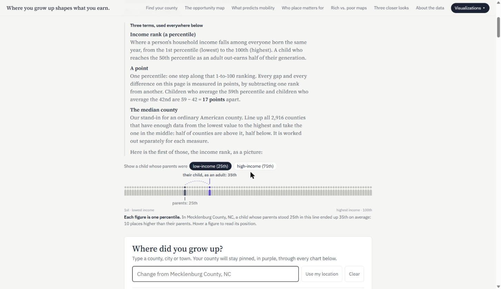
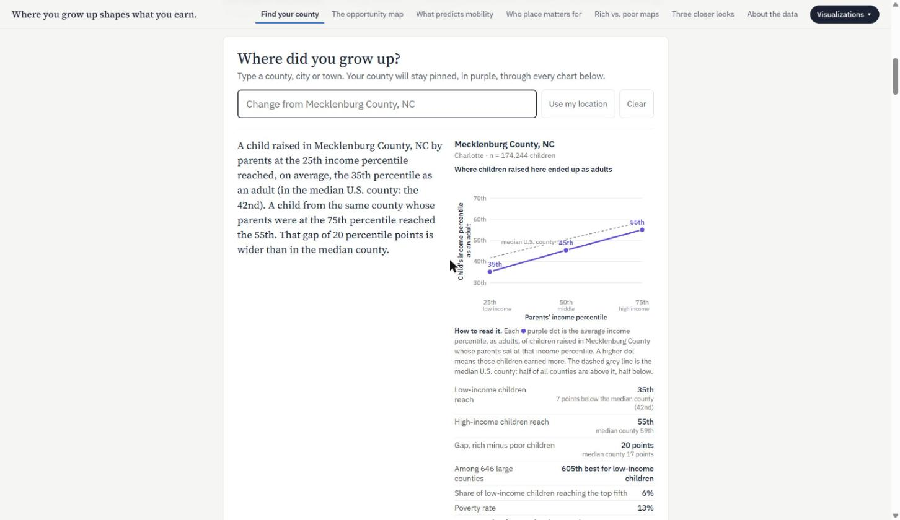
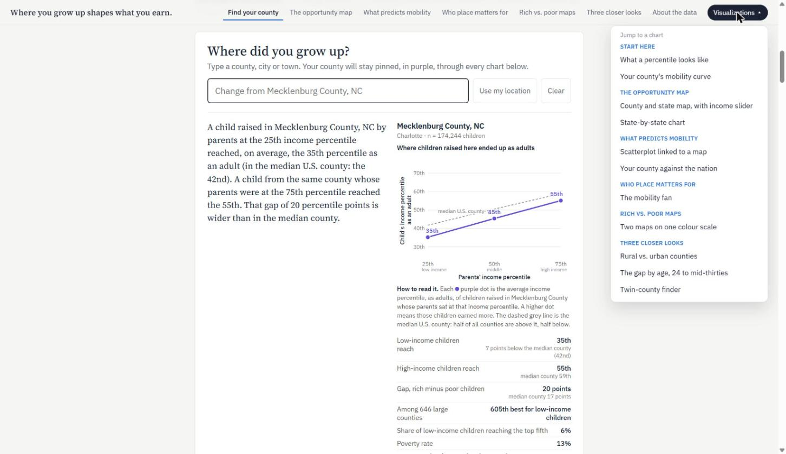
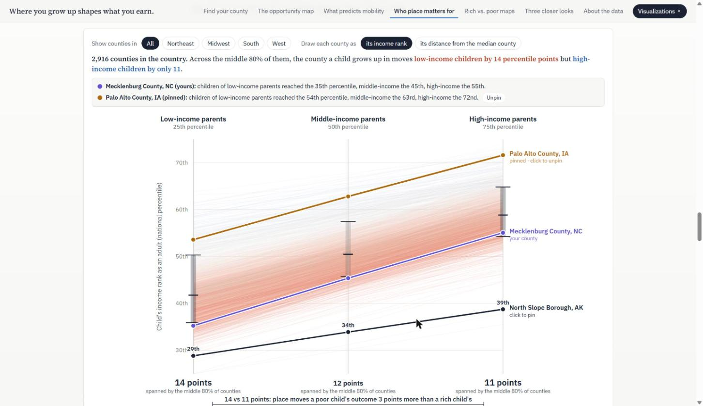
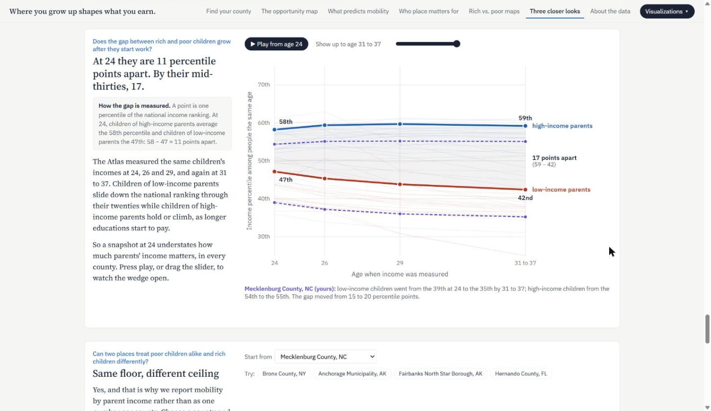

# Final project: Where you grow up shapes what you earn

## Team members who worked on this submission

- Atul Julka
- Lily Xu
- Liam Clower

## Links

- **Project website:** [https://lilyx-u.github.io/cs171-mobility-final-project/](https://lilyx-u.github.io/cs171-mobility-final-project/)
- **Code repository:** [https://github.com/lilyx-u/cs171-mobility-final-project](https://github.com/lilyx-u/cs171-mobility-final-project)
- **Screencast (2 minutes):** TODO: paste the video link or file name here.
- **Code and data:** the `cs171_final_project` folder submitted with this book. `README.md` explains how to run it and which libraries it uses; `DATA.md` describes every data field.

## Where the project stands

The site is finished. It is one scrolling data story in five parts, built with SvelteKit and D3 from the Opportunity Atlas and the Stanford Education Data Archive, with every chart drawn by our own code.

The message has not changed since Milestone 7: **place matters more for children of low-income parents than for children of high-income parents.** Across the middle 80% of counties, the county a child grows up in moves a low-income child's adult income rank by 14 percentile points and a high-income child's by 11.

Prototype V3 (Milestone 11) had every view built. The final round was about legibility: making sure a first-time reader knows what each axis, each dot and each unit means, and can find their way around the page.

## What changed between Prototype V3 and the final site

Each row is a piece of feedback we received on Prototype V3 and what we did about it.

| Feedback on Prototype V3 | What the final site does | Where |
|---|---|---|
| In "Where did you grow up?", label the y axis so it is obvious which percentile the child is in, and say what the points mean. | The county's mobility curve now has a titled y axis ("Child's income percentile as an adult"), a titled x axis ("Parents' income percentile", with low / middle / high income under the three ticks), the value written on each dot, a chart title, and a "How to read it" sentence under the chart explaining what a dot is. | `CountyDetail.svelte` |
| "Typical county": what is that referring to? | The phrase is gone. Everywhere it appeared the site now says "the median county", and the term is defined once at the top of the page (line up every county with enough data and take the middle one: half of counties are above it, half below) and again in the charts that use it. | `+page.svelte`, `CountyDetail.svelte`, `MobilityFan.svelte`, `CountyVsNation.svelte` |
| Make sure the pin works in the "place matters most" section. | It did not, in two ways: clicking a line gave no visible sign that anything had happened, and the pinned line vanished as soon as the cursor moved to another line, so two counties could never be compared. A pinned county is now drawn in its own colour (amber) and stays drawn while other lines are hovered; a bar above the chart names the pinned county and the reader's own county with their three numbers and an Unpin button; clicking the pinned line again releases it. | `MobilityFan.svelte` |
| Define a "point": how are we measuring points, for example in "Does the gap between rich and poor children grow after they start work?" | "A point" is now one of three terms defined at the top of the page (one percentile; gaps are one rank subtracted from another, with a worked example). The age-gap view carries its own boxed definition with the subtraction written out (58 minus 47 is 11 points at age 24), and the chart shows the same subtraction beside the gap label. Elsewhere "points" is written out as "percentile points". | `+page.svelte`, `AgePaths.svelte` |
| Remove the sentence linking to the two earlier lab prototypes. | Removed, along with the two prototype pages themselves; the final site is the story only. The prototypes remain documented in the earlier sections of this book. | `+page.svelte` |
| Add an animation when a navigation link is clicked. | Navigation links now scroll smoothly to their target, and when the scroll finishes the target plays a short arrival animation: a chart panel gets a blue ring that pulses outward, a section's opening text slides up into place. Readers who have asked their system for reduced motion get an instant jump instead. | `SiteNav.svelte`, `+layout.svelte` |
| Make the navigation titles match the sections and be more informative; consider a Visualizations menu. | The bar now names each part of the story ("The opportunity map", "What predicts mobility", "Who place matters for", "Rich vs. poor maps", "Three closer looks", "About the data"), and each part's heading on the page carries the same words. The link for the part being read is underlined as the page scrolls. A new **Visualizations** menu lists all eleven charts, grouped by part, and jumps straight to any one of them. On narrow screens the section links fold into a "Sections" menu. | `SiteNav.svelte`, `+page.svelte` |
| Make the title in the corner the first sentence. | The corner now reads "Where you grow up shapes what you earn." and returns to the top when clicked. | `SiteNav.svelte` |

## Changes made to publish the site

- The site now builds to plain static files (`npm run build`), so it can be hosted on GitHub Pages. A workflow in `.github/workflows/deploy.yml` builds and publishes it on every push.
- Data files are loaded relative to wherever the site is served from, so the same build works at a domain root and under `/<repository>/`.
- Every part and every chart has its own address (for example `/#viz-fan`), so a link can point at one chart.

## Final design, part by part

| Part | Question it answers | Views |
|---|---|---|
| Start | What is being measured, and where do I fit? | Percentile picture (100 figures); "Where did you grow up?" search and the chosen county's mobility curve |
| 1. The opportunity map | Are outcomes scattered at random? | County / state choropleth with a parent-income slider; state chart; best and worst lists |
| 2. What predicts mobility | What is it about a place? | Brushable scatterplot linked to a map; the chosen county against every other county |
| 3. Who place matters for | For whom does place matter most? (the main message) | The mobility fan, our novel view |
| 4. Rich vs. poor maps | What does that look like on the map? | Two choropleths on one shared colour scale |
| 5. Three closer looks | Rural or urban? When does the gap open? What does an average hide? | Density strips linked to a map; age paths with a play button; twin-county finder |
| About the data | What can these numbers say, and what can they not? | Sources, definitions, caveats |

## What we would still do with more time

- Keyboard access to the map shapes and chart marks. The controls are reachable by keyboard; the shapes themselves are mouse-only.
- Layout polish at phone widths for the fan and the state chart.
- A think-aloud session on the final wording, to check that "median county" and "point" now read the way we intend.
