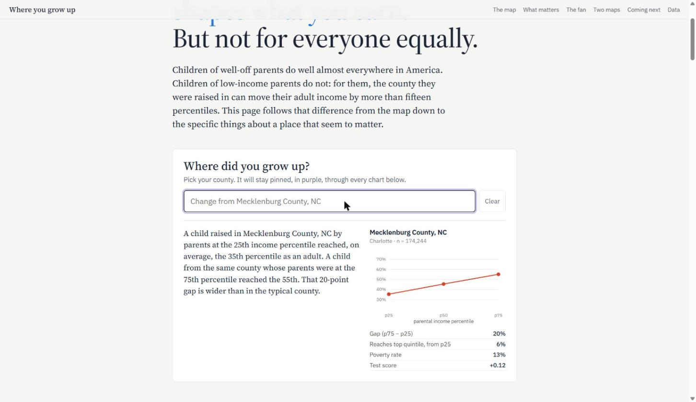
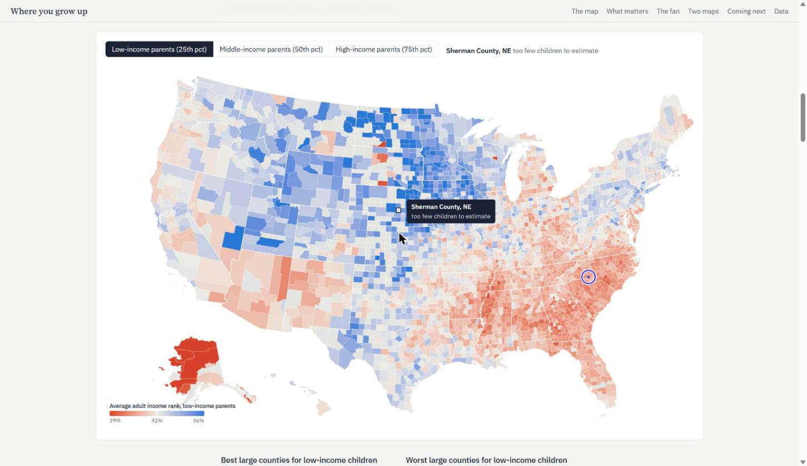
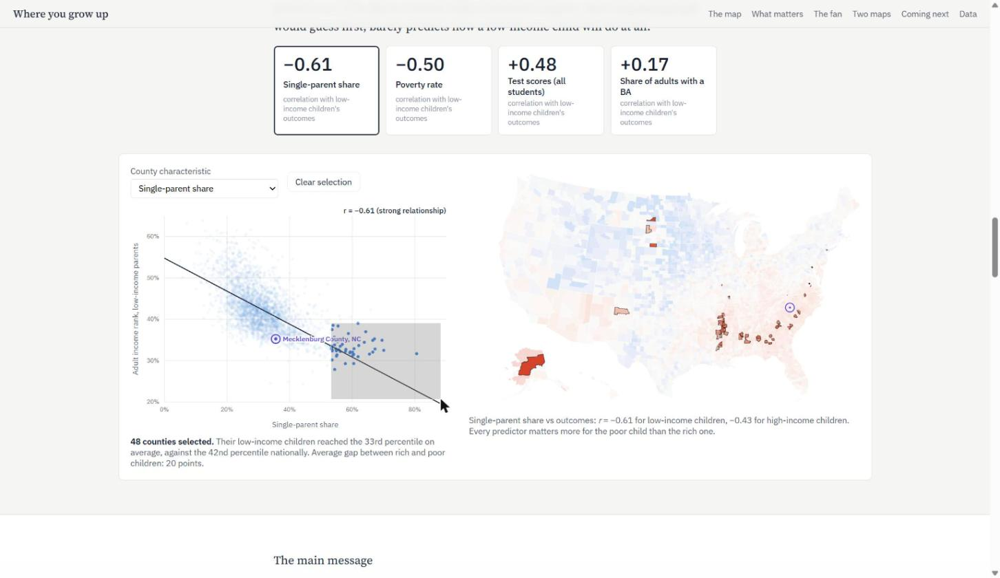
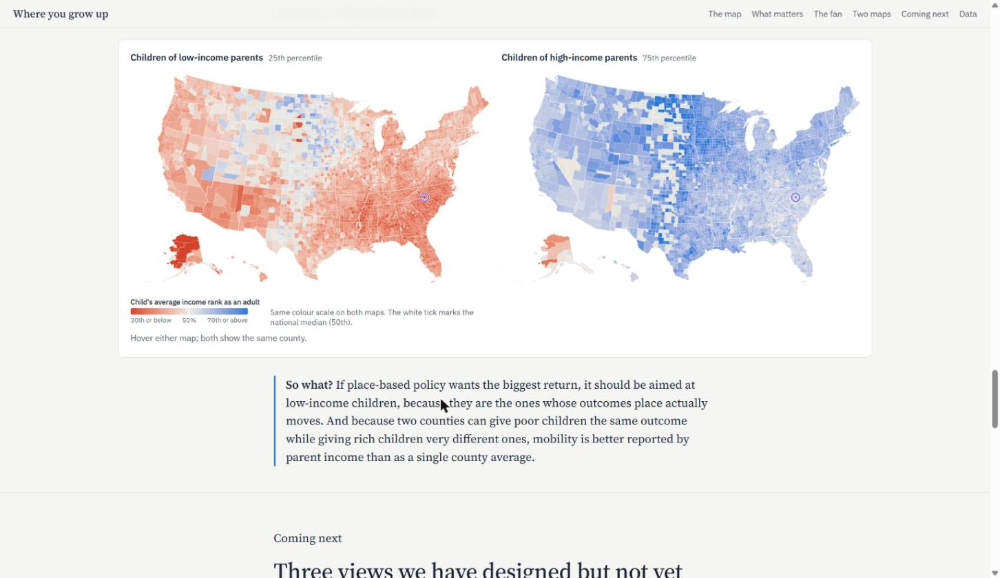
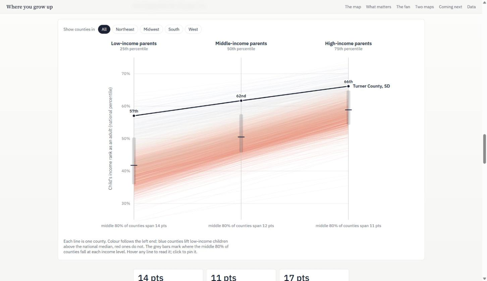
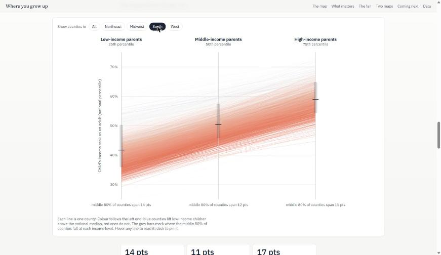
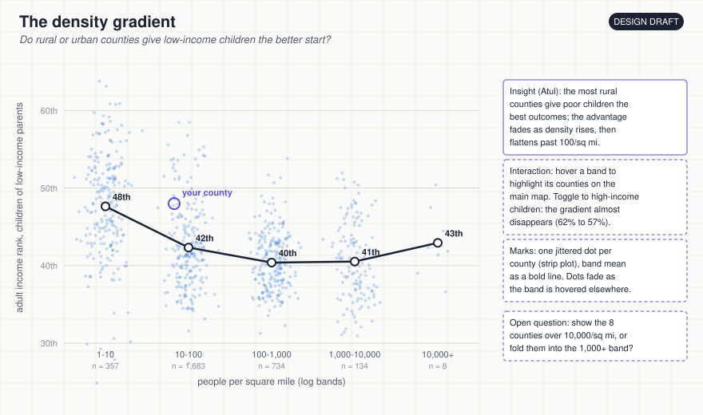
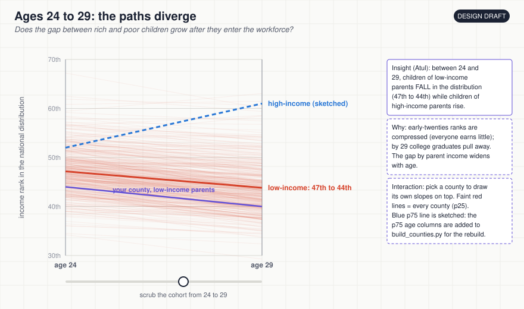
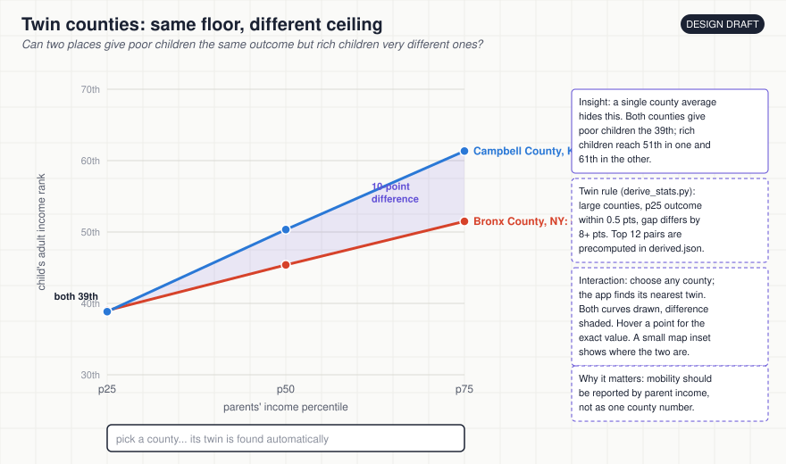

# Milestone 8: Prototype V1

## Team members on this submission

- Atul Julka (atuljulka@college.harvard.edu)
- Lily Xu (lilyxu1@college.harvard.edu)
- Liam Clower (lclower@college.harvard.edu)

All three of us worked on this prototype.

## What is in the submission

- A SvelteKit + D3 website at the project root. `npm install` then `npm run dev` and open the local URL. The story lives at `/`; the two Milestone 6 lab prototypes are still at `/a` and `/b`.
- The finished two-stage data pipeline in `scripts/` and its outputs in `static/`.
- Four working D3 views (two required, two extra), three visualization drafts generated from the real data, and this process book.

## 1. Data pipeline: complete

The pipeline has two stages and both run from the command line with no third-party Python packages.

**Stage 1, `scripts/build_counties.py`.** Reads the four raw files (Opportunity Atlas county outcomes, 184 MB; Atlas county covariates; SEDA 6.0 county test scores; SEDA county covariates), joins them on the five-digit county FIPS code, keeps 26 fields, rounds to four decimals and writes `static/counties.json` (3,131 counties, 1.5 MB). It prints a regression check against two published figures (Mecklenburg NC and Salt Lake UT) so a broken join fails loudly. The raw files are not in the zip because of their size; the docstring lists where to download them.

**Stage 2, `scripts/derive_stats.py` (new this milestone).** Reads `counties.json` and writes `static/derived.json` with everything the story page quotes: national means, standard deviations and the 10th to 90th percentile spread of outcomes at each parental income level; Pearson correlations of each county characteristic with outcomes for low- and high-income children; mean outcomes by population density band; mean rank at ages 24 and 29; a state-to-Census-region lookup; twelve "twin county" pairs; the best and worst large counties; and the example counties named in the prose. Computing these once means the numbers in the narrative always match the data and update automatically when the data is rebuilt.

**Cleaning decisions, all in code and documented there:**

- Counties with fewer than 1,000 children in the Atlas sample are flagged `reliable = false`, drawn grey on maps and excluded from the scatter, the fan and every summary statistic. 215 of 3,131 counties fall below the line.
- Opportunity Atlas privacy noise can push a share slightly below zero; shares are clamped at zero for display only, in `loadCounties()`.
- The rich-poor gap (`gap = kfr75 - kfr25`) and the Census region are computed at load time rather than stored.
- SEDA covers 3,134 of the Atlas's 3,219 counties and is a strict subset, so no fuzzy matching was needed; Puerto Rico, DC and a handful of tiny counties drop out.
- Two columns were added to the Stage 1 field list this milestone (`kfr_24` and `kfr_29` at the 75th percentile) for the age-slope draft. They will appear in `counties.json` the next time Stage 1 is run against the raw files.

| File | Rows | Key fields |
|---|---|---|
| static/counties.json | 3,131 counties | kfr25/50/75, top20_25/75, kfr24_25, kfr29_25, coll25/75, jail25, n, poverty, collshare, singlepar, medinc, popdens, jobdens, score, score_ecd, score_nec, learn, ses |
| static/derived.json | 1 object | national, correlations, density_bins, ages, regions, twins, examples, extremes |

## 2. Website structure and storytelling

The site is one long scrolling story. Its sections follow the Milestone 7 storyboard arc exactly: hook, rising insights, main message, solution, with a "coming next" section for the drafts and a data section for the caveats.

| Storyboard beat | Section on the page | View |
|---|---|---|
| Hook: "Where did you grow up?" | Header with county search; the chosen county is pinned in purple through every later chart and remembered between visits | County search + mobility curve |
| Rising insight 1: Plains blue, Southeast red | "Outcomes are not scattered at random" | Choropleth with parental-income toggle, tooltip, legend, best/worst lists |
| Rising insight 2: single-parent share is the strongest predictor; BA share only +0.17 | "Some things about a county predict mobility. Some don't." | Correlation tiles + brushable scatter linked to a map |
| Main message: affluent children do well everywhere, poor children depend on place | "Place matters most for the children who have the least" | The mobility fan (novel view) + three stat tiles |
| Two maps side by side | "Affluent children do well everywhere. Poor children depend on where they grow up." | Twin choropleths on one shared scale |
| Solution: place-based policy aimed at low-income children; report mobility by parent income | "So what?" pull quote | Text |
| Coming next | Three design drafts with sketches | Placeholders |
| About the data | Sources, definitions, caveats, team, links to the lab prototypes | Text |

A sticky navigation bar lists the sections, so a reader can jump straight to a chart or read top to bottom. Prose is set in Source Serif 4 at 18 px on a 680 px measure; chart labels and controls use IBM Plex Sans. The visual budget is spent in one place, the fan; everything else is quiet.

## 3. The two functional D3 visualizations (plus two more)

Every view loads `counties.json` and `derived.json` through `src/lib/data.js` (D3 `json`), projects the US Atlas TopoJSON with `d3.geoAlbersUsa`, and uses D3 scales, axes, brushes and colour interpolators; Svelte handles the DOM so that the four views share one state object (`story.home`, the reader's county).

**View 1: the county choropleth (`CountyMap.svelte`).** 3,131 county paths coloured by the average adult income rank of children at the chosen parental percentile. The toggle switches between low-, middle- and high-income parents. Colour is a diverging scale centred on that group's national mean, red below and blue above, with a neutral grey midpoint rather than a yellow one. Grey means too few children to estimate. Hovering shows a tooltip and a readout sentence; the legend sits inside the map. The reader's county is ringed in purple.

**View 2: predictors, a brushable scatter linked to a map (`Scatter.svelte` + `CountyMap.svelte`).** This grew out of Prototype B, which we said in Milestone 6 we would develop further. Four stat tiles show the correlation of single-parent share, poverty, test scores and BA share with low-income children's outcomes; clicking a tile or using the dropdown changes the scatter's x-axis. The scatter draws a least-squares line and prints r with a plain-language strength word. Dragging a box dims everything else and highlights the brushed counties on the map, with a sentence summarising the selection against the national average. Hit targets are larger than the dots so hovering does not require pixel accuracy.

**View 3 (extra): the mobility fan (`MobilityFan.svelte`).** Our novel view; see section 4.

**View 4 (extra): twin maps (`TwinMaps.svelte`).** The same choropleth component drawn twice on one shared scale centred at the 50th percentile, so blue means "children from this county end up above the median adult." The high-income map is blue coast to coast; the low-income map is where the geography lives. This is the "2 maps side by side" from the storyboard's main-message beat.

## 4. Novel view design: the mobility fan

**The idea.** We wanted one picture that *is* the main insight rather than a chart you have to reason about. The fan draws all 2,916 reliable counties as lines through three vertical axes: adult income rank for children of parents at the 25th, 50th and 75th percentile. Where the lines spread out, place matters; where they bunch together, it does not. The shape does the arguing: the middle 80% of counties span 14 percentile points on the left and 11 on the right.

**Encodings.**

- Position: three axes (parent income) against one shared y scale (child's adult rank, 25th to 75th).
- Line colour: the diverging red-blue scale evaluated at the *left* end, so colour follows whether a county lifts low-income children above the national median. The same scale as the twin maps, so the two views agree.
- Grey bars at each axis: the 10th to 90th percentile band across counties, with a tick at the median. These make the "spread" claim measurable instead of impressionistic.
- Purple: the reader's county, always on top.

**Interactions.**

- Region buttons (All, Northeast, Midwest, South, West) fade the others, so a reader can see, for example, that almost every Southern county starts below the median.
- Hovering finds the nearest line by interpolating every county's value at the cursor's x position (about 3,000 comparisons per mouse move, well within budget) and draws it on top with its three values labelled. Click pins it.
- The reader's own county is drawn on top of everything with a label.

**Why this and not a parallel-coordinates library or a slope chart?** A slope chart with two ends loses the middle axis, which shows the fan narrowing gradually rather than in one jump. A generic parallel-coordinates view would invite the reader to reorder and brush axes, which is not the point; this view has one fixed ordering because the ordering is the argument.

**What we learned building it.** Colouring by the left end makes most lines red, because most counties land low-income children below the national median; that is the honest picture, but it means the blue lines read faintly. We may add a "colour by region" alternative. The first version put the spread labels beside the axes, where the left one collided with the y-axis title; they now sit under the axes.

**Planned refinements for the final.** Animate the lines drawing in from left to right on first scroll into view (respecting reduced-motion); a small inset map that lights up the hovered county; a "compare two counties" mode that feeds the twin-counties draft.

## 5. Visualization drafts (designed, not yet built)

The sketches are generated from the real data by `process-book/drafts/make_drafts.py`, so positions are real; the annotation boxes carry the design notes. They appear on the website in the "Coming next" section as placeholders.

### Draft A: the density gradient

Question: do rural or urban counties give low-income children the better start? Atul's insight: the most rural counties (1 to 10 people per square mile) give children of low-income parents the best outcomes (48th percentile on average), and the advantage fades as density rises, flattening around the 40th past 100 per square mile. Form: a strip plot, one jittered dot per county inside five log-density bands, with the band means joined by a bold line. Interaction: hover a band to highlight those counties on the main map; a toggle switches to high-income children, where the gradient almost vanishes (62nd to 57th). Open question: whether to show the eight counties above 10,000 per square mile separately or fold them into the 1,000+ band.

### Draft B: ages 24 to 29, the paths diverge

Question: does the gap between rich and poor children grow after they enter the workforce? Atul's insight: between 24 and 29, children of low-income parents fall in the national distribution (47th to 44th on average) while children of high-income parents rise. Form: a slope chart with age on the x axis; the national line for each parent group in bold, every county's line faint behind it. Interaction: pick a county to draw its own slopes on top; a scrubber animates the cohort from 24 to 29. Data note: the p25 lines are real; the p75 columns were added to the Stage 1 script this milestone and the blue line is sketched until the next rebuild.

### Draft C: twin counties, same floor, different ceiling

Question: can two places give poor children the same outcome but rich children very different ones? Yes, and that is why a single county average hides the story. Stage 2 finds pairs of large counties whose low-income outcome is within half a point but whose rich-poor gap differs by eight points or more: Bronx County, NY and Campbell County, KY both land low-income children at about the 39th percentile; high-income children reach the 51st in one and the 61st in the other. Form: two mobility curves side by side with the difference shaded. Interaction: choose any county and the app finds its nearest twin; a small map inset shows where both are. This is the storyboard's "solution" beat made visible: mobility should be reported by parent income, not as one number.

## 6. Design system

- **Colour.** One diverging scale for outcomes (red `#d6422a`, neutral grey `#ecebe6`, blue `#2a78d6`), never a hue at the midpoint. A single-hue orange sequential ramp for the rich-poor gap on the lab prototype, because a gap is a magnitude, not a polarity. Purple `#6250d6` is reserved for the reader's county and used for nothing else. Grey `#e4e4e1` for counties too small to estimate.
- **Type.** Source Serif 4 for narrative and headings, IBM Plex Sans for labels, controls and chart text. Numbers in prose are spelled as percentiles ("the 35th percentile") because the audience may not know what an income rank is.
- **Chart rules we held to.** Thin marks, recessive grid, no dashed gridlines, legend present on every coloured view, hit targets larger than the marks, a readout sentence under every chart so no value is tooltip-only, direct labels only on the hovered or pinned county.
- **Layout.** Prose on a 680 px measure, charts break out to 1,120 px. Works down to 375 px with no horizontal scroll; grids collapse to one column below 760 to 980 px depending on the view.

## 7. What changed since Milestone 6, and why

- **Prototype B's bug** (hovering the map appeared to clear the brush selection) is fixed: hover and brush are now separate pieces of state, and hover never dims anything.
- **Controls are labelled by what they change** ("Colour the map by outcomes for...", "County characteristic") in answer to our own Milestone 6 note that users could not tell which view a control affected.
- **We kept Prototype A's detail panel** as the hook's mobility curve, as planned, and developed B into the predictors section.
- **The colour scale changed** from D3's red-yellow-blue to a red-grey-blue diverging scale, because a yellow midpoint reads as a category rather than "average".
- **Everything now shares one reader-chosen county**, which turned three separate charts into one story.

## 8. How we used Claude, and what we checked

As in Milestone 6, we used Claude Code to build from our designs rather than to design for us. This milestone it wrote the Stage 2 pipeline script, the new Svelte components and the first draft of the narrative copy from our storyboard, insights and "so what" statement. Things it got wrong that we or it caught by running the site rather than reading the code: a variable named `derived` collided with Svelte's `$derived` rune and crashed the page with a 500 (renamed to `summary`); the fan's spread labels overlapped the y-axis title (moved under the axes); the draft cards showed two "design draft" badges (one removed); and the draft sketch legends ran into their annotation boxes (re-laid out). We verified the quoted numbers (correlations, spreads, best and worst counties, twins) directly against `counties.json` with a separate script before putting them in the prose.

## 9. Next steps toward the final

1. Build drafts A, B and C; rerun Stage 1 to get the p75 age columns.
2. Add the fan's draw-in animation and inset map; try the "colour by region" alternative and user-test both.
3. Scroll-driven reveals so each chart appears with its paragraph, and a share-your-county link.
4. A table view for every chart, for accessibility and for readers who want the numbers.
5. User testing with three people from the target audience (18 to 30, not economists) and a round of copy edits from what they misread.
