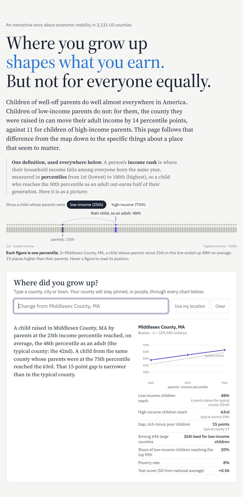
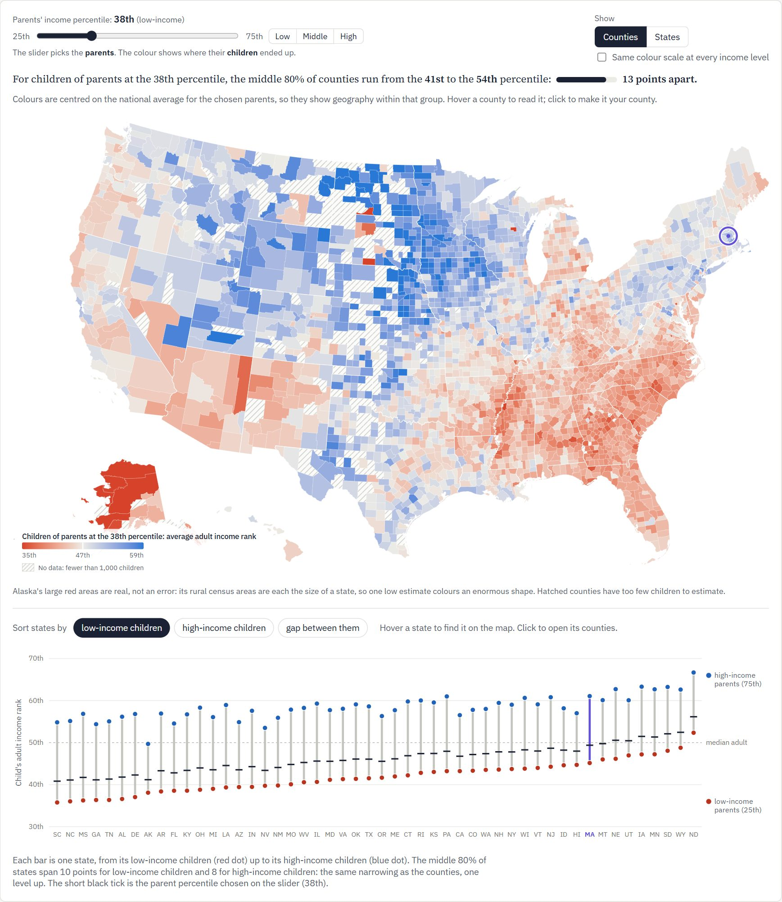
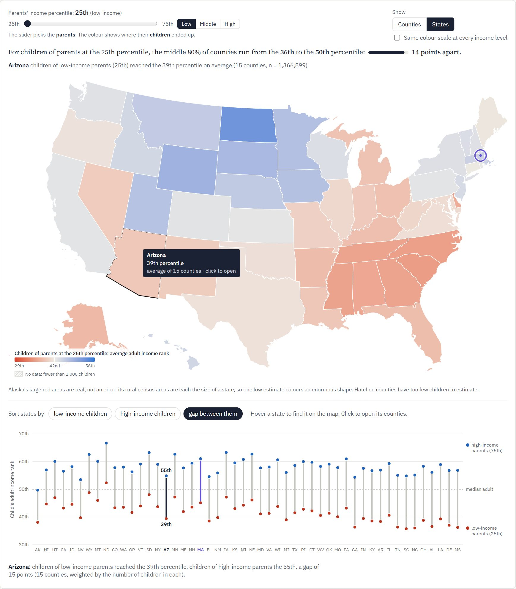
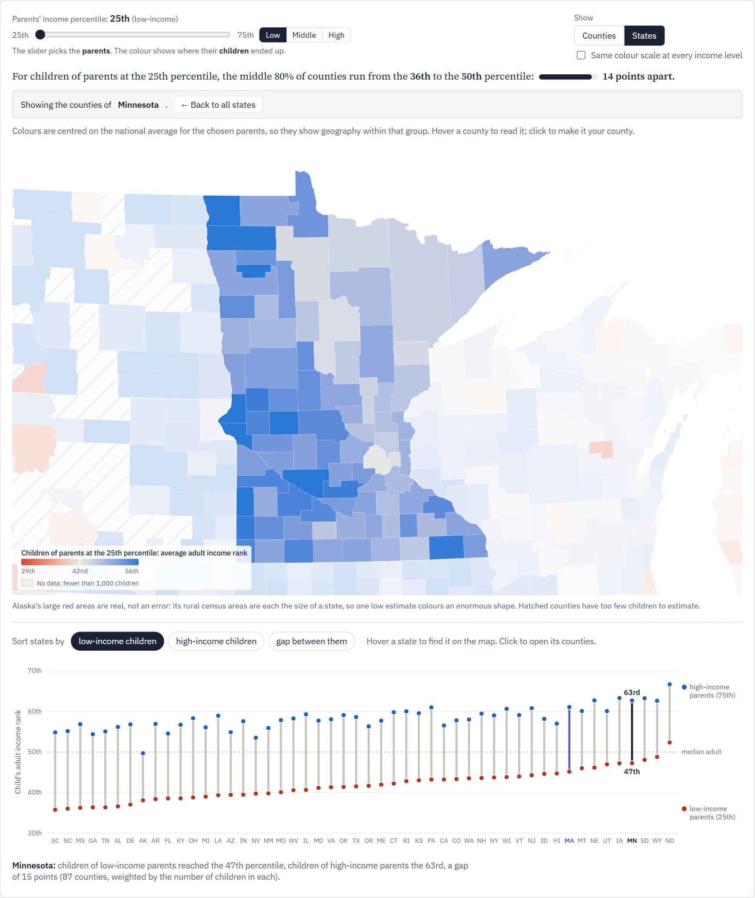
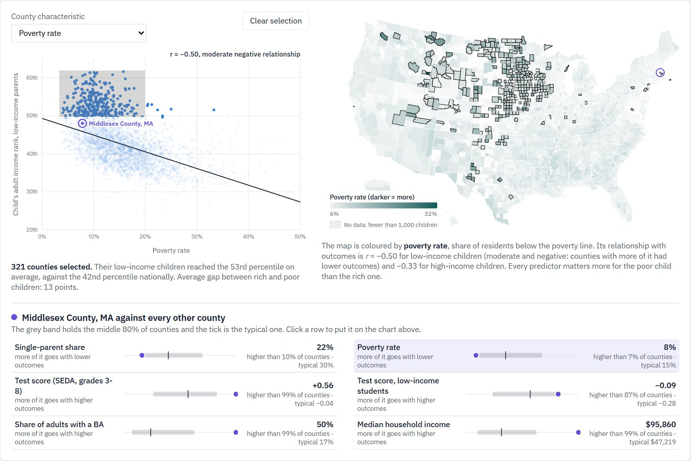
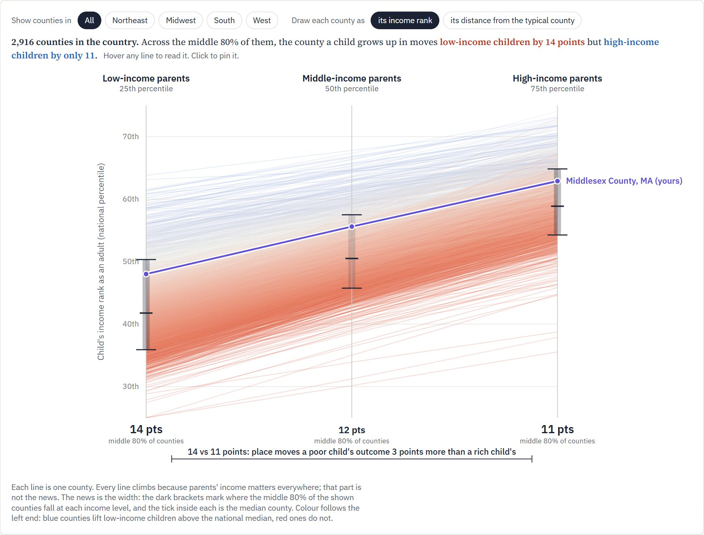
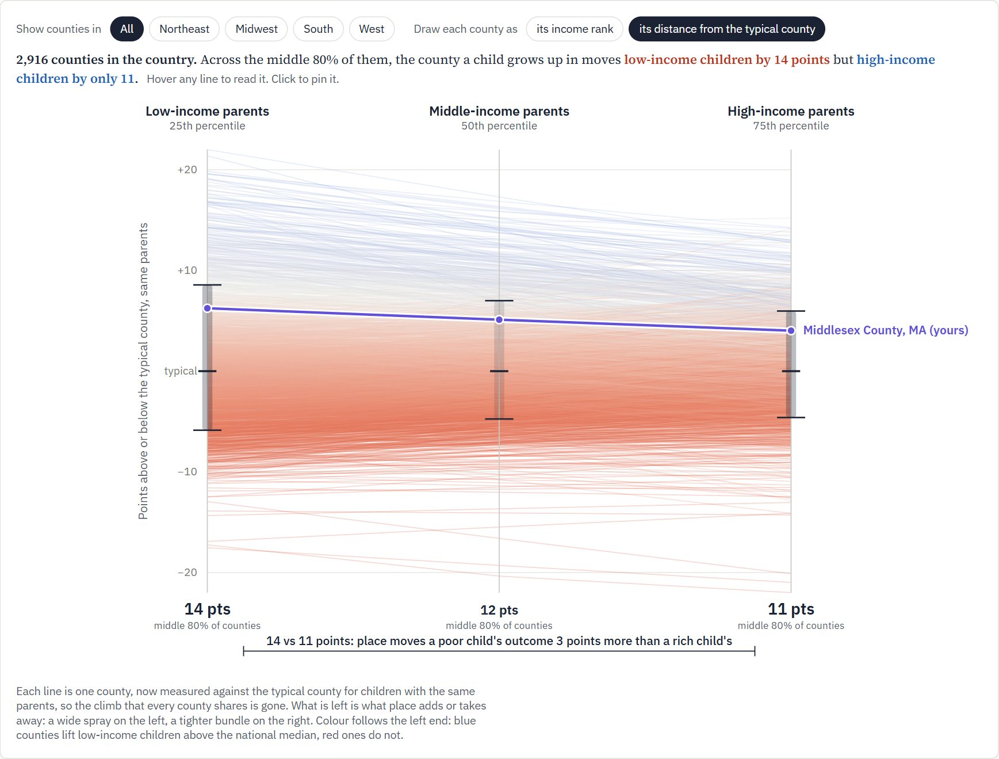
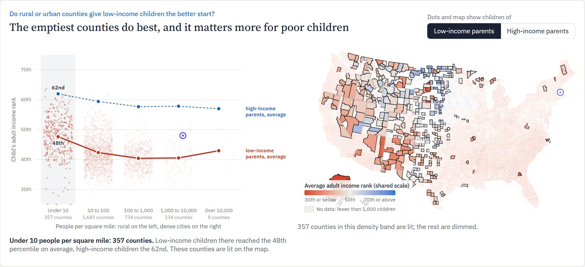
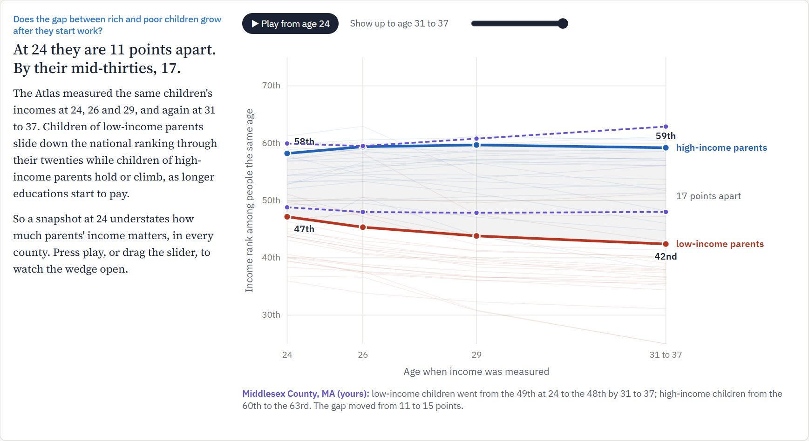
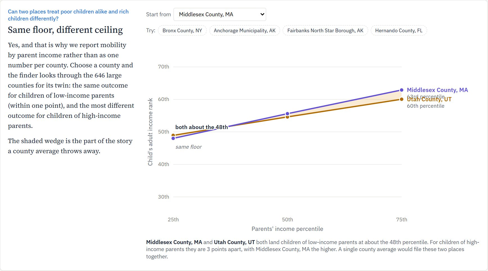

# Milestone 11: Prototype V3

## Team members who worked on this submission

- Atul Julka
- Lily Xu
- Liam Clower

## Where the project stands

Prototype V3 is the data story at roughly 95% complete. Every view on the page is now a working, interactive D3 visualization built from the real datasets; the "design drafts, not yet built" section from V1 and V2 is gone because all three drafts have been built. The page has one route for the story (`/`) and keeps the two Milestone 6 lab prototypes at `/a` and `/b`.

The message has not changed since Milestone 7: **place matters more for children of low-income parents than for children of high-income parents.** Across the middle 80% of counties, the county a child grows up in moves a low-income child's adult income rank by 14 percentile points and a high-income child's by 11. V3 is about making every part of the page say that, and about finishing what the two think-aloud testers asked for.

## How V3 responds to the test session

Milestone 10 recorded 24 requests from two testers (Praneel Khiantani and Wesley Ekes). Prototype V2 implemented 13 of them; they are listed as "done" in the Milestone 10 decisions table. V3 takes the rest, plus the two additions we committed to in our Milestone 10 reflection (a state-level view and a continuous parent-income slider).

| Feedback from the test session | What V3 does | Where |
|---|---|---|
| "A state level view or state grouping, since people recall their state faster than their county." | The main map has a Counties / States switch. In the state view each state is one shape; clicking a state flies the map into it and shows its counties. A new state chart under the map (one bar per state, low-income to high-income children) is linked to the map both ways. | `CountyMap.svelte`, `StateLadder.svelte` |
| "A slider that moves the parental percentile continuously instead of three fixed tabs." | A slider from the 25th to the 75th percentile replaces the three tabs (which remain as Low / Middle / High shortcuts). The map, legend, readout, the sentence above the map and the best/worst lists all follow it. | `+page.svelte`, `data.js` (`kfrAt`) |
| "A picture of what a percentile actually is, a row of 100 people with one highlighted, before the first chart." | A row of 100 figures sits directly under the definition, before any chart. It marks where the parents stood and where their child ended up, switches between low-income and high-income parents, and uses the reader's own county once they pick one. | `PercentileRow.svelte` |
| "A 'your county versus the nation' card showing where your county's single-parent share, poverty and test scores sit nationally." | A card under the scatterplot places the pinned county on all six characteristics against the middle 80% of counties, and says which direction each one leans. Clicking a row puts that characteristic on the scatterplot and the map. | `CountyVsNation.svelte` |
| "Map cities and towns to counties in the search, or add a 'use my location' option." | V2 added cities and towns. V3 adds "Use my location": the browser's coordinates are matched to a county inside the browser against the boundary file already loaded. Nothing is sent anywhere. | `CountySearch.svelte`, `data.js` (`countyAt`) |
| "Let the paragraph and the table follow the selected tab." | The best and worst lists are computed live for the slider's position, for states when the state view is on, and for one state when the map is zoomed into it. A sentence above the map restates the spread at the current slider position. | `+page.svelte` |
| "The high-income map tab is hard to understand since the grey bars carry the argument but are subtle." | The sentence above the map states the argument in numbers and a small bar ("the middle 80% of counties run from the 36th to the 50th percentile: 14 points apart") and shrinks as the slider moves toward richer parents. | `+page.svelte` |
| The fan "mostly reads as rich parents mean rich kids"; "he could see every line sloping up and could not see the width difference." | A second reading of the fan: "distance from the typical county". Each axis is re-centred on its median county, which removes the climb every county shares and leaves only the spread. The prose now says outright that the climb is not the point. | `MobilityFan.svelte` |
| "The drafts section, which is not meant for the viewer." | Removed. The three drafts are built as "Three closer looks" (below). | `DensityStrips`, `AgePaths`, `TwinFinder` |
| "Some of the visualizations feel a little redundant in information, so try to diversify." | The page had five maps and one scatterplot besides the fan. V3 adds four non-map forms: the state chart, a strip plot by density band, a slope chart over age, and a paired-curve comparison. | see below |
| "Alaska is just one giant dark red block on every map and looks like a data error." | A one-line note sits directly under the main map (V2 only had it in the data notes at the bottom). The projection already insets Alaska; the state view also reduces it to one averaged shape. | `+page.svelte` |

One bug surfaced while testing V3 ourselves: the page was meant to remember the reader's county between visits, but an effect erased the saved value before it was read. That is fixed.

## Data pipeline (complete)

All data on the page comes from the real sources; nothing is mocked.

| Stage | Script | Input | Output |
|---|---|---|---|
| 1 | `scripts/build_counties.py` | Opportunity Atlas county outcomes (193 MB, 10,827 columns) and county covariates; SEDA 6.0 county test scores and covariates | `static/counties.json`, 3,131 counties |
| 1b (new) | `scripts/add_age_paths.py` | The public Atlas county outcomes file | Adds income rank at ages 24, 26 and 29 for children of low-income and high-income parents |
| 2 | `scripts/derive_stats.py` | `counties.json` | `static/derived.json`: national summaries, correlations, regions, twin pairs, age averages |
| 3 | `scripts/build_places.py` | Public city-to-county list | `static/places.json`, 29,708 cities and towns |

Stage 1b was written for this milestone because the age view needed columns we had not carried through. It downloads nothing itself: it reads the Atlas file, joins on the five-digit county code, and refuses to write unless the three columns already in `counties.json` match the raw file exactly. On our run all 3,131 counties matched with zero disagreements.

Two decisions about the data are worth recording:

- **The slider does not invent data.** The Atlas publishes each county at the 25th, 50th and 75th parent percentile. We checked that the published 50th-percentile value sits within 0.35 points of the midpoint of the other two in every one of the 2,916 reliable counties, which is what you would expect because the Atlas estimates are a straight line in parents' rank within each county. So a slider position of, say, the 38th reads the Atlas's own line. In Milestone 10 we had declined the slider on the grounds that it would "show movement that is not in the data"; this check is what changed our minds. We stop at the 25th and 75th and do not extrapolate.
- **State figures are weighted.** A state's value is the average of its reliable counties weighted by the number of children in each, so it reads as the average child raised there, not the average county.

## Website structure

1. **Hook.** Headline, the one definition (now with the percentile picture), and "Where did you grow up?" with search by county, city or town, or by location. The chosen county is pinned in purple through every chart.
2. **The map.** County or state choropleth with the parent-income slider, a shared-scale option, the state chart, and best/worst lists that follow the controls.
3. **What matters.** Correlation tiles, a brushable scatterplot linked to a map coloured by the chosen characteristic, and the county-versus-nation card.
4. **The fan (the main message).** Every county as a line across three parent-income levels, with region filter and the two readings.
5. **Two maps.** Low-income and high-income children on one shared scale, followed by the "So what?" box.
6. **Three closer looks.** Density, age, and twin counties.
7. **About the data.** Sources, definitions and limits, including the new notes on the slider, state averages and location.

## Visualizations and their interactions

| View | Type | Interactions |
|---|---|---|
| Percentile picture | Unit chart, 100 figures | Switch parent group; hover a figure; follows the pinned county |
| Main map | Choropleth, county or state | Slider for parents' percentile; county/state switch; click a state to zoom; shared-scale option; hover tooltip; click a county to pin it (with undo) |
| State chart | Range (dumbbell) chart, 50 states | Sort three ways with animated reordering; hover links to the map; click opens the state on the map; marks the slider position |
| Scatterplot and characteristic map | Scatter with fit line; sequential choropleth | Choose the characteristic; brush dots to outline counties on the map; map hover marks the dot |
| County versus nation | Six distribution strips | Click a row to change the scatterplot and map |
| Mobility fan | Parallel coordinates, 2,916 lines | Region filter that recomputes every statistic; two readings; hover nearest line; click to pin |
| Twin maps | Two choropleths, one scale | Linked hover |
| Density gradient | Jittered strip plot with group means, linked map | Hover a band to light its counties on the map; switch parent group |
| Paths by age | Slope chart, ages 24 to mid-thirties | Play button and scrubber; hover a county; pinned county drawn on top |
| Twin finder | Paired mobility curves | Choose any large county or use your own; example pairs |

## Innovative visualization and interaction design

### The mobility fan, and its second reading

The fan is the view we designed for this project: parallel coordinates in which each of 2,916 counties is one line through three axes (parents at the 25th, 50th and 75th percentile), with brackets marking where the middle 80% of counties fall at each axis. The argument is the change in bracket height from left to right.

Both testers understood the page's message, but both said the fan, the chart we label "the main message", read first as "rich parents mean rich kids", because the eye follows the slope of the lines before it compares the widths. V2 answered with labels. V3 answers with a transformation.

Subtracting each axis's median county from every line on that axis removes exactly the part of the picture all counties have in common and keeps the part that differs between places. The brackets, their numbers and the hover labels are computed from the same filtered set of counties in both readings, so the two are the same data, not two charts. We kept the rank reading as the default because it is the one a new reader can decode without help; the prose under the heading now tells them the climb is "true, and not the point" and sends them to the switch.

### Geography at two scales in one map

Rather than add a separate state map, the state view is a mode of the main map. States are painted on the same colour scale as counties (the scale is always computed from counties, so a colour never changes meaning when the mode changes). Clicking a state animates the map into that state and reveals its counties; the lists below follow. The state chart is a second door into the same interaction, for readers who find "MN" in a sorted row faster than they find Minnesota on a map.

### Three closer looks (the former drafts, now built)

Each closer look backs one sentence of the story. The density view shows where the pattern is strongest, and corrected our draft: the draft's caption said the gradient "nearly disappears" for high-income children, but with the real numbers on screen it falls 7 points for low-income children and 4 for high-income children, so the built view says "matters more", not "disappears". The age view shows that the gap between the two groups opens during their twenties in nearly every county. The twin finder is the evidence for the last sentence of the "So what?" box, that one average per county hides two different stories.

## Storytelling

The order of the page is the argument: a definition the reader can see, their own county, the national map, what predicts the pattern, the fan, the same fact on two maps, and the "So what?". The closer looks come after the conclusion on purpose, so a reader who stops at the "So what?" has the whole message. The reader's county is carried through nine of the ten views, and the same two numbers (14 and 11) are quoted from one source in the introduction, above the map, on the fan and in its tiles.

## How we checked it

We drove the page in a headless browser through 25 interaction checks (location lookup, town search, the slider at the 25th, 38th and 75th, state view, zoom, brush, card rows, both fan readings, region filter, density hover, age scrubber, twin finder, reload, phone width). All 25 pass and the page logs no errors; the two lab prototypes also load cleanly.

## What is left for the final version

- Keyboard access to map shapes and chart marks (controls are reachable; the shapes are mouse-only).
- Layout polish on phones: nothing scrolls sideways, but the fan and the state chart are small at that width.
- A think-aloud pass on the new views, which no outside tester has seen yet.
- Final copy edit and hosting.

## How we used Claude

Claude Code wrote the V3 code from the Milestone 10 feedback tables and our list of committed changes. Two things came from checking rather than from the plan: the linearity test on the Atlas columns that made the slider defensible, and the discovery that the saved-county feature had never worked. We reviewed the screenshots and the interaction checks before accepting each view.
